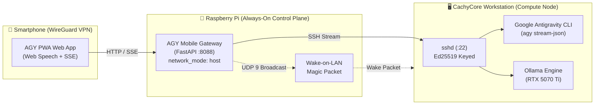

# 🚀 AGY Mobile Gateway

<p align="center">
  
</p>

<p align="center">
  <b>A lightweight, mobile-first Web Gateway & PWA for Google Antigravity Agent (AGY) and Local LLMs (Ollama).</b><br>
  Built for developers who want to control their high-performance workstation from a smartphone via WireGuard, without terminal friction.
</p>

---

## ✨ Features

- 📱 **Mobile-First PWA:** Native-like touch experience, installable to Home Screen on iOS & Android with zero browser bars.
- 🎙️ **Zero-Latency Voice Dictation:** Seamless voice-to-text using the browser's native **Web Speech API** (runs 100% on-device on iOS/Android; zero server overhead, zero GPU VRAM used).
- ⚡ **Real-Time Streaming:** Server-Sent Events (SSE) streaming token-by-token directly from `agy --output-format stream-json` or local Ollama endpoints.
- 🗂️ **Session History & Multi-Turn:** Integrated slide-over drawer to browse, resume, or delete previous conversation sessions.
- 🔀 **Model Switcher:** Seamlessly switch between Google Antigravity cloud reasoning models (`Gemini 3.8 Flash`, `Gemini 4 Argon`, `Claude Sonnet 5.5`, `GPT-OSS`) and local GPU models running in Ollama.
- 💤 **Fake Sleep & Wake-on-LAN Sentinel:** Designed for workstations running in **Fake Sleep (C0 Idle / screens blanked)**; includes automated Wake-on-LAN (Magic Packet) fallback if the target workstation is powered off (S5) or in deep sleep (S3).
- 🔒 **Zero Public Ports:** Operates entirely over your private LAN or personal WireGuard VPN tunnel.

---

## 🏗️ Architecture



---

## 🚀 Quickstart

### 1. Requirements
- A target workstation with **Google Antigravity CLI (`agy`)** installed and listening on SSH.
- A 24/7 host (e.g. Raspberry Pi, home server) running Docker & Docker Compose.
- Secure network connectivity between devices (LAN or WireGuard VPN).

### 2. Setup
Clone this repository to your gateway server (e.g. `/opt/stacks/agy-gateway`):

```bash
git clone https://github.com/your-username/agy-mobile-gateway.git /opt/stacks/agy-gateway
cd /opt/stacks/agy-gateway
```

Generate a dedicated SSH keypair for the gateway:
```bash
mkdir -p ssh data
ssh-keygen -t ed25519 -f ssh/id_ed25519 -N "" -C "agy-gateway"
chmod 600 ssh/id_ed25519
```

Authorize the public key (`ssh/id_ed25519.pub`) in your compute node's `~/.ssh/authorized_keys`:
```bash
cat ssh/id_ed25519.pub | ssh user@workstation-ip "mkdir -p ~/.ssh && cat >> ~/.ssh/authorized_keys"
```

Configure your environment variables in `.env` (or edit `compose.yaml`):
```env
TARGET_HOST=192.168.1.190
TARGET_USER=ai
WOL_MAC=bc:fc:e7:ca:84:05
PORT=8088
```

### 3. Deploy
```bash
docker compose up -d --build
```

Access the interface on your smartphone at `http://<gateway-ip>:8088` while connected to your VPN!

---

## 📄 License
MIT License. Feel free to fork, customize, and contribute!
