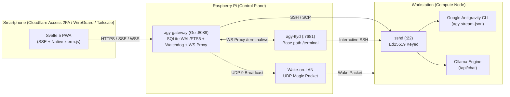

# AGY Mobile Gateway

<p align="center">
  
</p>

<p align="center">
  <b>A mobile-first Web Gateway & PWA for Google Antigravity CLI (AGY) and Local LLMs (Ollama).</b><br>
  Control your workstation from anywhere via Cloudflare Tunnel (Zero Trust + 2FA) or WireGuard/Tailscale VPN with resumable SSE jobs, file transfers, Wake-on-LAN, and a native mobile SSH terminal.
</p>

---

## Features

- **Compiled Go Core (`backend-go/`):** Single zero-CGO static binary embedding the compiled Svelte 5 frontend (`//go:embed`) and SQLite `WAL` + `FTS5` via `modernc.org/sqlite`.
- **Prebuilt Binaries Available:** Download ready-to-run executables for Windows (`x86_64`), Linux (`x86_64`/`arm64`), and macOS (`arm64`) from [GitHub Releases](https://github.com/Phoenix7290/agy-mobile-gateway/releases/latest).
- **Mobile-First Svelte 5 PWA:** Compiled with Vite + TypeScript + Tailwind CSS v4 (`~120 KB` gzipped), designed for one-handed smartphone use with zero horizontal overflow.
- **Resumable Job Engine & SSE:** Decoupled job execution persisted in SQLite (`WAL` mode) with `after=` / `Last-Event-ID` stream resumption and `visibilitychange` auto-reconnect (survives switching apps on iOS/Android).
- **Three Gateway Modes (`GATEWAY_MODE`):** `standalone` (local PC on Linux/macOS/Windows), `gateway` (24/7 Raspberry Pi orchestrating workstation over SSH/SCP + WoL), and `ide-bridge` (`.agy-bridge/inbox|outbox` JSON file-queue bridge).
- **Model Switcher & Effort Tiers:** Supports Google Antigravity cloud models (`Gemini 4 Hydrogen` Medium/High/Extra, `Gemini 3.8 Flash`, `Gemini 4 Argon`, `Claude Sonnet/Opus 5.5`, `GPT-OSS 120B`) and local GPU models via Ollama (`/api/chat` with persistent history).
- **Optional Audio Transcription Mod (`Whisper`):** Enable `ENABLE_WHISPER=true` + `WHISPER_URL` to expose `POST /api/transcribe` backed by any OpenAI-compatible `faster-whisper` endpoint.
- **Selectable Permission Modes & Persistent Settings:** Switch between `Copiloto` (`--mode accept-edits`), `Autônomo` (`--dangerously-skip-permissions`), and `Leitura` (`--mode plan`), with defaults persisted in SQLite via the Sidebar Configs tab.
- **Slash Commands Palette (`/`):** Quick mobile access to `/usage` (live quota breakdown table), `/compact`, `/plan`, `/clear`, `/diff`, `/mem`, and `/status`.
- **Inbox & Outbox File Transfers:** Upload photos, camera captures, or documents from your phone directly to `~/agy-inbox/` on the workstation, and download generated files from `~/agy-outbox/`.
- **Native `xterm.js` WebSocket Terminal (HITL):** Integrated `xterm.js` client proxied via `/terminal/ws` to `ttyd`, featuring `visualViewport` keyboard resizing and quick action keys.
- **Full-Text Search (FTS5) & Pagination:** Instant conversation filtering backed by SQLite FTS5 and paginated loading.
- **Watchdog & Wake-on-LAN:** Background 60s health watchdog on the Raspberry Pi with dynamic **Acordar** (UDP `255.255.255.255:9` Magic Packet) button when the workstation is offline.

---

## Architecture



---

## Repository Structure

```text
agy-mobile-gateway/
├── backend-go/              # Go backend (zero-CGO, static binary, embedded UI)
│   ├── cmd/agy-gateway/     # HTTP/SSE API, WS proxy, health watchdog, tests
│   └── internal/            # config, db (SQLite+FTS5), jobs (+ ide_bridge), runner, web, wol
│       └── web/static/dist/ # Compiled Svelte 5 bundle embedded via //go:embed
├── frontend/                # Svelte 5 + Vite + TypeScript + Tailwind v4 source
├── docs/INSTALL.md          # Multi-platform installation & download guide
├── compose.yaml             # Docker Compose stack (Go agy-gateway + agy-ttyd)
├── Dockerfile               # Multi-stage Go container build
├── Dockerfile.ttyd          # Custom ttyd WebSocket terminal image
├── AGENTS.md                # Guidelines for AI coding agents
└── CONTRIBUTING.md          # Collaboration guide for contributors
```

---

## Quickstart & Development

See the full multi-platform guide (including direct Windows binary downloads, Antigravity IDE workflows, and optional mods) in [docs/INSTALL.md](docs/INSTALL.md).

### 1. Standalone (Prebuilt Release Binary)
Download the matching binary for your OS from [GitHub Releases](https://github.com/Phoenix7290/agy-mobile-gateway/releases/latest) and run it with `GATEWAY_MODE=standalone`.

### 2. Gateway Setup (Raspberry Pi / Docker)
```bash
git clone https://github.com/Phoenix7290/agy-mobile-gateway.git /opt/stacks/agy-gateway
cd /opt/stacks/agy-gateway
mkdir -p ssh data
ssh-keygen -t ed25519 -f ssh/id_ed25519 -N "" -C "agy-gateway"
chmod 600 ssh/id_ed25519
```

Authorize `ssh/id_ed25519.pub` on the compute node, configure `.env` if overriding defaults (never commit `.env` or private keys), and start the stack:
```bash
docker compose up -d --build
```

### 3. Local Development (Frontend + Go Backend)
```bash
# Frontend (compiles directly into backend-go/internal/web/static/dist/)
cd frontend
npm install
npm run build

# Go backend tests & dev server
cd ../backend-go
go test -v -race ./...
GATEWAY_MODE=standalone go run ./cmd/agy-gateway
```

---

## License
MIT License. Feel free to fork, customize, and contribute!
