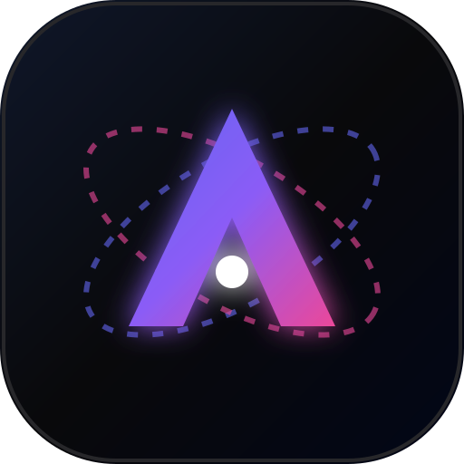
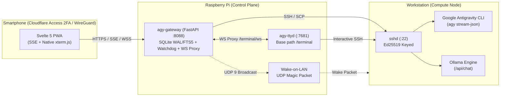

# AGY Mobile Gateway

<p align="center">
  
</p>

<p align="center">
  <b>A mobile-first Web Gateway & PWA for Google Antigravity CLI (AGY) and Local LLMs (Ollama).</b><br>
  Control your workstation from anywhere via Cloudflare Tunnel (Zero Trust + 2FA) or WireGuard VPN with resumable SSE jobs, file transfers, and a native mobile SSH terminal.
</p>

---

## Features

- **Mobile-First Svelte 5 PWA:** Compiled with Vite + TypeScript + Tailwind CSS v4 (`~120 KB` gzipped), designed for one-handed smartphone use with zero horizontal overflow.
- **Resumable Job Engine & SSE:** Decoupled job execution persisted in SQLite (`WAL` mode) with `Last-Event-ID` stream resumption and `visibilitychange` auto-reconnect (survives switching apps on iOS/Android).
- **Model Switcher & Effort Tiers:** Supports Google Antigravity cloud models (`Gemini 4 Hydrogen` Medium/High/Extra, `Gemini 3.8 Flash`, `Gemini 4 Argon`, `Claude Sonnet/Opus 5.5`, `GPT-OSS 120B`) and local GPU models via Ollama (`/api/chat` with persistent history).
- **Selectable Permission Modes & Persistent Settings:** Switch between `Copiloto` (`--mode accept-edits`), `Autônomo` (`--dangerously-skip-permissions`), and `Leitura` (`--mode plan`), with defaults persisted in SQLite via the Sidebar Configs tab.
- **Slash Commands Palette (`/`):** Quick mobile access to `/usage` (live quota breakdown table), `/compact`, `/plan`, `/clear`, and `/status`.
- **Inbox & Outbox File Transfers:** Upload photos, camera captures, or documents from your phone directly to `~/agy-inbox/` on the workstation, and download generated files from `~/agy-outbox/`.
- **Native `xterm.js` WebSocket Terminal (HITL):** Integrated `xterm.js` client proxied via `/terminal/ws` to `ttyd`, featuring `visualViewport` keyboard resizing, quick action keys (`Esc`, `Tab`, `Ctrl+C`, arrows, `sudo`, `Colar`), and automatic `fastfetch` suppression on mobile sessions.
- **Full-Text Search (FTS5) & Pagination:** Instant conversation filtering backed by SQLite FTS5 and paginated loading.
- **Watchdog & Wake-on-LAN:** Background 60s health watchdog on the Raspberry Pi with dynamic **Acordar** (WoL Magic Packet) button when the workstation is offline.

---

## Architecture



---

## Repository Structure

```text
agy-mobile-gateway/
├── app/
│   ├── main.py              # FastAPI backend, SSE job engine, WS proxy, Watchdog, Inbox/Outbox APIs
│   ├── db.py                # SQLite WAL persistence, FTS5 search index, settings & job buffers
│   └── static/
│       ├── dist/            # Built Svelte 5 production bundle served at /
│       ├── icon.svg
│       └── manifest.json
├── frontend/                # Svelte 5 + Vite + TypeScript + Tailwind v4 source
│   └── src/
│       ├── App.svelte
│       ├── lib/             # Typed API client & Hegemonia-style SVG icon registry
│       └── components/      # Sidebar, TerminalModal (xterm.js), OutboxModal, Icon
├── compose.yaml             # Docker Compose stack (agy-gateway + agy-ttyd)
├── Dockerfile
├── Dockerfile.ttyd
├── requirements.txt
├── AGENTS.md                # Guidelines for AI coding agents
└── CONTRIBUTING.md          # Collaboration guide for contributors
```

---

## Quickstart & Development

### 1. Gateway Setup (Raspberry Pi / Server)
```bash
git clone https://github.com/Phoenix7290/agy-mobile-gateway.git /opt/stacks/agy-gateway
cd /opt/stacks/agy-gateway
mkdir -p ssh data
ssh-keygen -t ed25519 -f ssh/id_ed25519 -N "" -C "agy-gateway"
chmod 600 ssh/id_ed25519
```

Authorize `ssh/id_ed25519.pub` on the compute node, configure `.env` from `.env.example` (never commit `.env` or private keys), and start the stack:
```bash
docker compose up -d --build
```

### 2. Frontend Development (Local)
```bash
cd frontend
npm install
npm run dev      # Vite dev server with /api & /terminal/ws proxy
npm run build    # Compiles production bundle into ../app/static/dist/
```

---

## License
MIT License. Feel free to fork, customize, and contribute!
